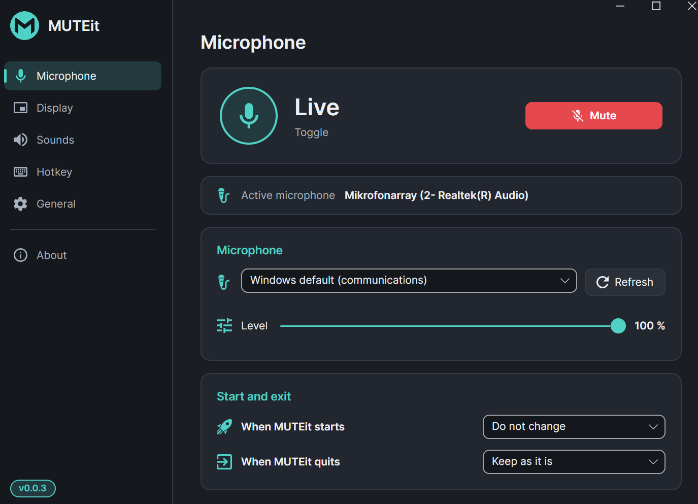

# MUTEit

**A small microphone switch for Windows that lives in the system tray. One click, one hotkey or one tap on the taskbar mutes your microphone – for every program at once. No account, no telemetry, no tracking.**

MUTEit mutes the microphone itself through the Windows audio system, so Teams, Discord, Zoom, OBS, games and the browser are all muted at the same time. The tray icon always shows the state: an accent-coloured dot means *live*, a red dot with a slash means *muted*. A global hotkey (keyboard or mouse button) works as a toggle, as push-to-talk or as push-to-mute. If another program mutes the microphone, MUTEit notices it right away.



## Features

- **Tray icon as indicator.** Accent dot = live, red dot = muted. A left click mutes or unmutes; a right click opens the menu with *Settings…* on top.
- **Three modes**
  - *Toggle*: every press of the hotkey switches.
  - *Push-to-talk*: muted by default, live while you hold the hotkey.
  - *Push-to-mute*: live by default, muted while you hold the hotkey (cough button).
- **Global hotkey** with keys, key combinations (e.g. *Ctrl + Alt + Shift + M*), a single modifier (e.g. *Right Ctrl*) or a mouse button (middle, back, forward).
  - *Ignore extra modifiers*: the hotkey also works while you sprint (Shift) or crouch (Ctrl) in a game.
  - *Swallow the hotkey*: other programs do not see it.
- **Choose your microphone:** the Windows default for communications (default), the Windows default, all microphones at once, or a specific device. Plugged and unplugged devices are picked up automatically.
- **Always in sync.** Changes made by Teams, Discord, the Windows sound settings or a hardware button show up in MUTEit at once.
- **Confirmation sounds** for muted and live, played on the output device you choose (e.g. your headset), with their own volume and test buttons: built-in sounds, any Windows sound or your own WAV files.
- **Desktop overlay** (off by default): a small state icon above all windows – microphone symbol (default) or MUTEit logo – in the size and opacity you like. Place it in a corner of any monitor with one click, or drag it anywhere. A click on it switches. It never takes the focus away from your game or call.
- **Taskbar button** (off by default): an own button on the taskbar. One click mutes or unmutes, a red or accent badge shows the state – also when the button is pinned. The focus goes straight back to the window you were in.
- **Own icons:** one image of your own (MUTEit adds the state badges) or one image per state, for tray, overlay and taskbar.
- **Microphone level** right in the settings window.
- **Start and exit state:** keep, mute or unmute the microphone when MUTEit starts or quits.
- **Dark and light design** in the Windows 11 style. Dark is the default, accent colour Teal; optionally the Windows accent colour and Mica transparency (both off by default).
- **English and German.** Chosen automatically from the Windows display language; you can switch it in the settings without a restart.
- **Small footprint.** The tray runs on Windows Forms. The settings window (Avalonia) is a separate process that only starts when you open it.

## How to use it

| Action | What happens |
| --- | --- |
| **Left click** on the tray icon | Mute / unmute |
| **Right click** on the tray icon | Menu: **Settings…**, state, mute / unmute, mode, microphone, desktop overlay, taskbar button, start with Windows, exit |
| **Hotkey** (default *Ctrl + Alt + Shift + M*) | Depending on the mode: switch, push-to-talk or push-to-mute |
| **Click** on the desktop overlay | Mute / unmute (can be switched off); drag it to move it |
| **Click** on the taskbar button | Mute / unmute; right click: *Settings*, *Exit MUTEit* |
| **Start MUTEit.exe again** | Opens the settings window of the running MUTEit |
| Settings › **Microphone** | Active microphone, state with mute / unmute button, microphone choice, level, state at start and exit, notes |
| Settings › **Display** | Desktop overlay (show, symbol, position, size, opacity), taskbar button, own icons |
| Settings › **Sounds** | Sounds on / off, output device, volume, test, sound per state (built-in, Windows sound, own WAV) |
| Settings › **Hotkey** | Mode, hotkey box (click and press the keys), ignore modifiers, swallow the hotkey |
| Settings › **General** | Start with Windows, language, design (dark / light / like Windows), Mica, Windows accent colour, update check, export / import / reset, settings folder |

All changes take effect immediately – there is no *Save* button.

### Hotkey box

Click the box and press the new hotkey.

- **Backspace, Delete or Esc** once removes the hotkey.
- Pressed **twice quickly**, the key itself becomes the hotkey.
- A **single modifier** (e.g. Right Ctrl): press and release it.
- **Mouse buttons:** middle, back and forward, also together with Ctrl / Alt / Shift / Win.

### Command line

For scripts, Stream Deck and similar tools:

```
MUTEit.exe --toggle
MUTEit.exe --mute
MUTEit.exe --unmute
MUTEit.exe --settings
MUTEit.exe --exit
```

## Installation

- **Installer:** `muteit_v0.0.3_setup.exe`. Installs for all users by default; *only for me* (without admin rights) can be chosen at the start. Check boxes: *Start with Windows* and *Desktop shortcut* (on), *Desktop overlay* and *Taskbar button* (off).
- **Portable:** unpack `muteit_v0.0.3_portable.zip` and start `MUTEit.exe`. The file `MUTEit.portable` next to the EXE keeps the settings in `data\` beside it.

On the first start MUTEit adds itself to the Windows autostart (for the current user) and shows a short hint. You can switch the autostart off in the menu.

Requirements: Windows 10 (1809) or Windows 11, 64-bit. The release builds are self-contained, so no separate .NET installation is needed.

## Notes

- **Programs running as administrator:** while such a window has the focus (some games and launchers), Windows does not pass keys to MUTEit. The tray icon, the overlay and the taskbar button keep working.
- **Exclusive full screen:** games in exclusive full screen draw above the overlay. Borderless and windowed games are fine.
- **Push-to-talk and exit:** when MUTEit quits in push-to-talk mode, the microphone stays muted unless you choose *Unmute* under *When MUTEit quits*.
- **Swallowing the hotkey** can keep special keys or mouse buttons from working in other programs. Switch it off if a program misses a key.
- **Taskbar button:** *Close window* on the taskbar only removes the button. Alt+Tab never switches the microphone.
- **Privacy:** MUTEit makes no network connections – except the optional update check (off by default) to GitHub. See [licenses/PRIVACY.md](licenses/PRIVACY.md).

## License

MUTEit is released under the **MIT License**. Copyright © 2026 Sven Klocke (*sksdesign | complicatiion*). See [licenses/](licenses/) for the license, legal notes and the third-party licenses (.NET, Avalonia, CommunityToolkit.Mvvm, Inter, Material Design Icons).

**Links:** [sksdesign.de](https://sksdesign.de) · [GitHub](https://github.com/complicatiion/MUTEit)
